[回到知識庫總索引](https://released.github.io/)

# M480 Secure Boot ISP 更新流程

> 使用 ICP 配置開機選項與金鑰，再透過 HSUSB SecureBootTool 部署韌體。APROM 保留更新入口，讓更新後的應用程式仍可再次進入 Secure ISP。

## 適用範圍與閱讀順序

參考環境為 **M487JIDAE、NuMaker-PFM-M487 V3.0、ICP Programming Tool 3.23** 與 **`[0213 0921] SecureBootTool.exe`**。其他 M480 型號、工具版本及客製板須核對其 ROM API、記憶體與 USB 條件。

| 專案情況 | 閱讀位置 | 狀態 |
| --- | --- | --- |
| 使用專用 LDROM 作為 Secure ISP 入口 | [ICP 配置](#icp-setup) → [首次部署](#first-programming) → [SW2 重複更新](#repeat-update) | 使用者已確認核心更新循環可執行 |
| LDROM 已有自訂 boot code，可能沒有剩餘空間 | [自訂 LDROM 的適用條件與更新範圍](#custom-ldrom) | 需符合既有開機與記憶體配置；APROM／SRAM 方案尚未實作與驗證 |
| USB 連線或更新後啟動失敗 | [分階段排查](#troubleshooting) | 依目前可觀察狀態確認 |

**範例金鑰：** 截圖中顯示的 Secure Boot key 與 KPROM key 為公開教學範例，用來對照兩套工具的輸入。實際產品使用專案自己的金鑰與匯出紀錄；圖片中的個人路徑已遮蔽。

## 1. 工具、記憶體與金鑰分工

| 項目 | 負責工作 | 本參考流程的輸入 |
| --- | --- | --- |
| ICP Tool＋Nu-Link | 首次寫入 CONFIG、KPROM、Secure Boot key | Boot Loader、Security Lock、Boot Option、兩類金鑰 |
| MCU Mask ROM Secure Bootloader | 開機驗證、Secure ISP command mode、更新 API | 晶片內建，不佔用使用者 LDROM 程式空間 |
| 專用 LDROM 入口 | APROM 要求更新後，初始化 HSUSB 並呼叫 ROM API | `ldrom.bin` |
| APROM 應用程式 | 正常功能與 SW2 更新要求 | `aprom.bin`；每個版本均保留更新入口 |
| SecureBootTool | KPROM 認證、韌體傳輸與驗證資訊更新 | Key0／Key1／Key2、Key Options 的 SBK、目標 BIN |

### 兩類金鑰的用途

| 金鑰 | 內容 | 設定位置 | 更新時如何使用 |
| --- | --- | --- | --- |
| KPROM key | 96-bit；三個 32-bit word | ICP 的 KPROM Options | 工具連線時，在認證視窗依序輸入 Key0、Key1、Key2，解除所需寫入保護 |
| Secure Boot key（SBK） | 256-bit | ICP 的 Secure Key；可匯出為 key BIN | 在 SecureBootTool 的 **Key Options** 提供同一把 key，產生對應映像驗證資訊 |

KPROM key 與 SBK 不能互相代用。SBK 與 Information Block（IB）參與開機驗證；載入 SBK 檔案與勾選韌體更新區是不同操作。

### HSUSB 接線與首次狀態

- PC 資料線接 **CON1（MCU HSUSB）**；CON2 為另一組 USB，Nu-Link USB 則供 ICP／除錯使用。
- Nu-Link 可維持原有供電連接；切至 SecureBootTool 前，ICP 須 **Disconnect**，並結束會保持 MCU reset／halt 的 debug session。
- 本範例 LDROM 入口使用板上 **12 MHz HXT**。自訂板的時鐘與 HSUSB 接法須另外核對。
- 首次 APROM／LDROM 尚未安裝時，不依賴 SW2。SW2 是 APROM 程式執行後才提供的入口。

## 2. 已驗證參考方案的操作總覽

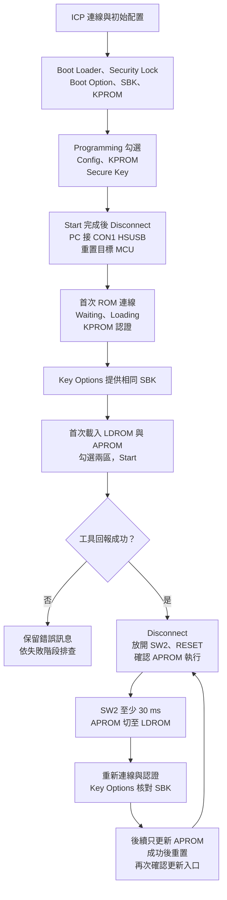

此圖的 LDROM 是專用更新入口。產品已有自訂 boot code 時，先依 [整合條件](#custom-ldrom) 選擇入口與驗證配置。

[開啟完整尺寸的操作總覽圖](assets/diagrams/operation-overview.svg)。

## 3. ICP：CONFIG、Secure Boot key 與 KPROM

### 3.1 連線並開啟 Config Bits

1. 用 Nu-Link 連接目標 MCU，ICP 選擇對應 M480 型號並 Connect。
2. 確認 Part No. 為預期晶片。
3. 在 **Config Bits → Setting** 開啟 Chip Settings。

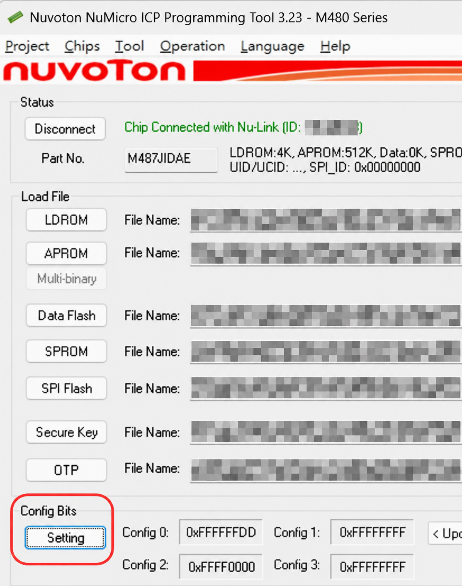

畫面中的韌體檔案欄位可能保留先前載入項目；實際寫入範圍由下方 Programming 勾選決定。

### 3.2 Boot Loader、Security Lock 與 Boot Option

1. 勾選 **Boot Loader**。
2. 勾選 **Security Lock**。
3. 選擇產品需要的 **Boot Option**；本已驗證範例的正常目的地為 **APROM**。
4. 確認後按 OK，回到 ICP 主畫面。

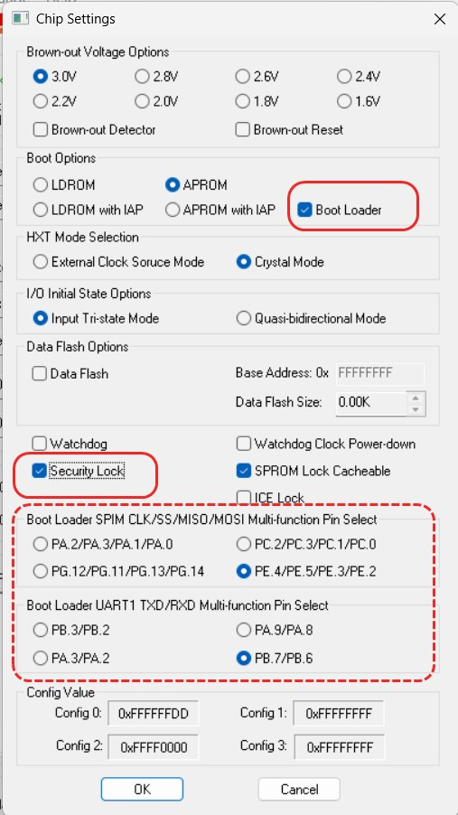

**ICP 3.23 介面行為：** 勾選 Boot Loader 後，工具會將 Secure Boot key 的寫入項目強制勾選並反灰，要求提供相關 key。Programming 中 Secure Key 為灰色勾選，仍代表該項目需要寫入。

Security Lock 與 Secure Boot 驗證的底層設定屬不同欄位。核對實際 CONFIG 與工具流程，才能確認完整安全配置。本範例的設定紀錄如下，僅適用此參考環境：

| 項目 | 參考值／意義 |
| --- | --- |
| CONFIG0 | `0xFFFFFFDD`；MBS=0、CBS=3，GUI 為 APROM＋Boot Loader |
| CONFIG2 | `0xFFFF0000`；SBLOCK=0，啟用此型號的 Secure Boot 驗證 |
| 正常開機目的地 | CONFIG0[7]=1；驗證後進入 APROM |
| IAP | 此 Mask ROM／Secure Boot 路徑會啟用 IAP；直接開機模式則須另核對 IAP 選項 |

Boot Option 可選 APROM、LDROM、APROM with IAP 或 LDROM with IAP，依既有 boot code 的執行位置與 IAP 需求設定。自訂 LDROM 的開機與 IB 條件見 [第 7 節](#custom-ldrom)；設定值不能跨型號直接套用。

### 3.3 建立、匯出並載入 Secure Boot key

1. 開啟 **Tool → Create Secure Boot Key File (M480 Only)**。

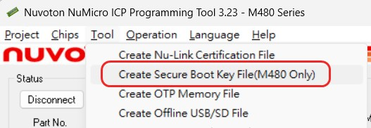

2. 使用專案既有 key，或於首次建立時按 **Generate** 產生 256-bit key。

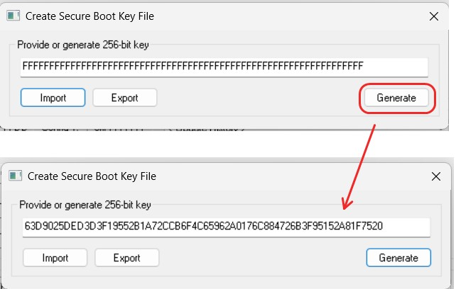

3. 按 **Export** 儲存 key BIN，例如 `secure_boot_key.bin`，並保管其對應產品／批次紀錄。

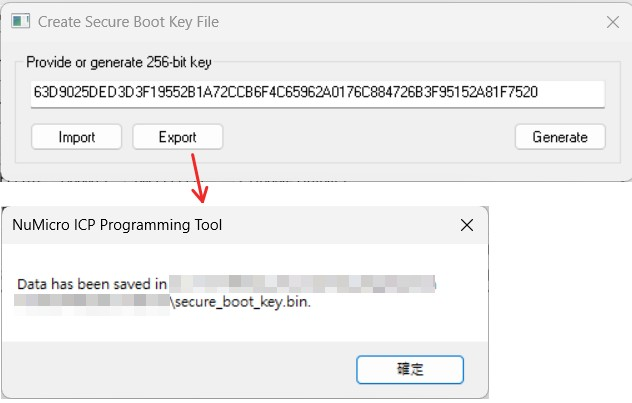

4. 回到 ICP 主畫面，按 **Secure Key** 載入該 key BIN。後續 SecureBootTool 的 Key Options 使用相同 SBK 內容。

已配置 SBK 的晶片後續更新沿用原 key；重新產生另一把 key 不會改變晶片中既有的 SBK。

### 3.4 填寫 KPROM key

1. 開啟 **KPROM Options**。
2. 依產品金鑰紀錄填入 **Key0、Key1、Key2**，三個欄位各為一個 32-bit word。
3. 依產品需求設定寫入保護範圍與錯誤認證次數限制。
4. 使用 Export 保管對應紀錄，再按 OK。後續認證視窗維持相同 word 順序。

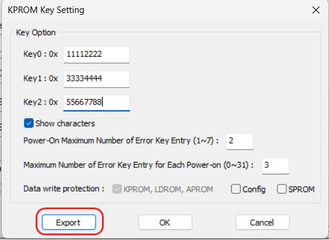

錯誤次數限制與保護範圍由產品決定；圖中數值屬範例配置，不是所有專案的固定要求。

### 3.5 勾選寫入項目並 Start

本參考流程由 ICP 寫入安全配置，再由 SecureBootTool 部署 LDROM／APROM：

| ICP Programming 項目 | 本次首次配置 |
| --- | --- |
| Config（Option Bytes／CONFIG） | 勾選 |
| KPROM | 勾選 |
| Secure Key | 勾選；此介面會因 Boot Loader 設定而強制勾選並反灰 |
| APROM、LDROM | 此階段不勾選；兩份韌體在 SecureBootTool 階段部署 |
| 其他記憶體區 | 依產品需求；本參考流程不更新 |

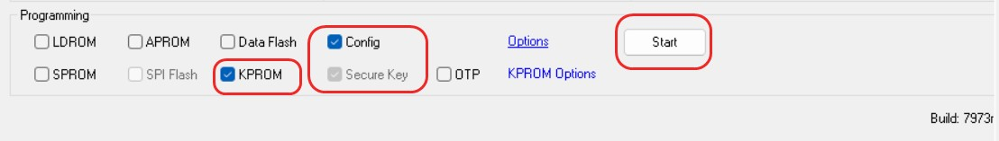

1. 核對已載入的 SBK、KPROM 設定及 Programming 勾選。
2. 按 **Start**，等待工具回報完成。
3. 按 **Disconnect**，結束 ICP 連線，再重置或重新上電，進入下一節。

**首次狀態條件：** 參考板在僅配置金鑰／CONFIG、APROM 與 LDROM 均空白時可進入首次認證。僅增加 LDROM 而 APROM 仍空白的另一種部署狀態曾無法連線；不能把所有「APROM 空白」情況都當成同一入口。

### 3.6 安全鎖定後的 ICP 提示

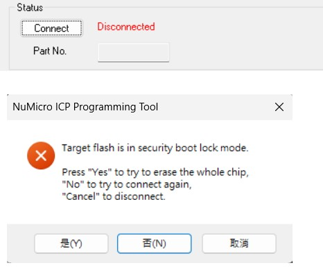

若 ICP 顯示 **Target flash is in security boot lock mode** 並詢問 whole-chip erase，代表這次 ICP 連線受到安全配置限制。維護既有產品時依核准的恢復程序處理；日常 Secure ISP 更新直接使用後續流程。整片擦除會涉及既有韌體與金鑰，不作為一般更新的連線步驟。

## 4. SecureBootTool：連線、認證與 Key Options

本節是首次部署與後續更新共用的連線流程。依目前狀態先使用 [首次入口](#first-programming) 或 [SW2 入口](#repeat-update)，再進行下列操作。

### 4.1 選 USB，依序等待 Waiting 與 Loading

1. 開啟 **`[0213 0921] SecureBootTool.exe`**。
2. Connection Interface 選 **USB**，按 **Connect**。
3. 等待工具取得 MCU HSUSB 裝置。此時按鈕顯示 Stop check，狀態為 **Waiting for usb connection ...**。

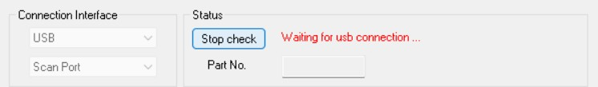

4. 取得裝置後會進入 **Loading ...**，等待通訊建立完成。

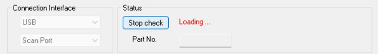

5. 接著狀態進入 **Verifying KPROM Key ...**，並顯示金鑰視窗。

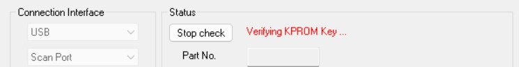

停在 Waiting 與已出現 KPROM 視窗是不同階段；處理方式見 [排查表](#troubleshooting)。

### 4.2 輸入 ICP 配置的 KPROM key

1. 在 **Input Key of KPROM to Unlock** 視窗，依 ICP 匯出紀錄填入 Key0、Key1、Key2。
2. 按 **OK**，等待驗證及晶片資訊讀取。

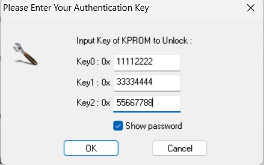

3. 確認狀態為 **Connected**，Part No. 與 APROM／LDROM 容量符合目標晶片。

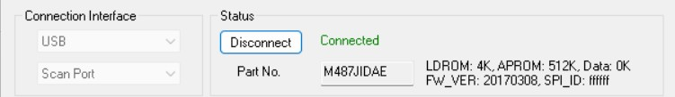

金鑰驗證失敗時，先核對原始紀錄與 word 順序；KPROM 可能配置錯誤次數限制，不使用猜測方式重試。

### 4.3 從 Key Options 提供同一把 Secure Boot key

1. 點 Programming 區的 **Key Options**。

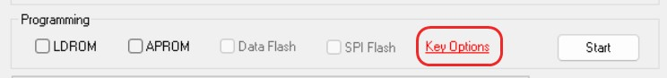

2. 在 **Provide 256-bit key** 欄位提供 ICP 寫入的相同 SBK 內容，與保管的 `secure_boot_key.bin` 對應。本教學截圖以可見的 key 內容示範對照。
3. 按 **OK**，回到主畫面。

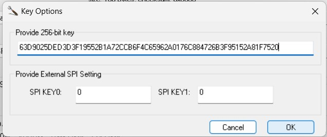

此工具介面使用 **Key Options**，Programming 列沒有獨立的 Signature 勾選框。SBK 由工具用於映像驗證資訊；KPROM 認證成功後仍須完成此項設定。

## 5. 首次部署：寫入專用 LDROM 入口與 APROM

**前置條件：** 完成第 3 節的首次 ICP 配置，使用已確認可連線的空白 APROM／LDROM 基準。APROM 尚未執行，因此首次連線使用 ROM 入口，不需要 SW2。

1. 接妥 CON1，ICP Disconnect 後重置或重新上電。
2. 依 [第 4 節](#secure-tool-connection) 等待 Waiting → Loading → KPROM 視窗，完成認證及 Key Options。
3. 在 **Load File → LDROM** 載入專用入口 `ldrom.bin`。
4. 在 **Load File → APROM** 載入含 SW2 入口的 `aprom.bin`。

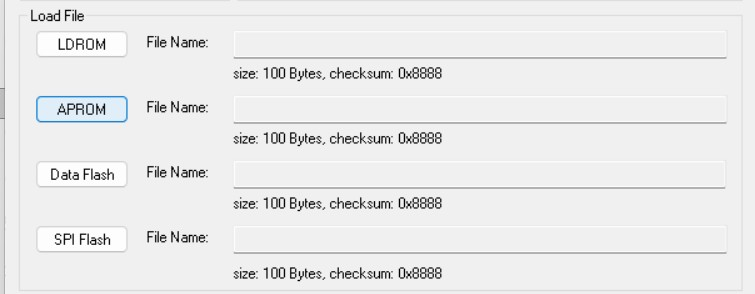

5. Programming **同時勾選 LDROM 與 APROM**；確認兩份映像均已載入，按 **Start**。
6. 等待工具明確回報成功，再 Disconnect。放開 SW2，按板上 RESET 或重新上電。
7. 確認 APROM 正常輸出 log，且可使用下一節的 SW2 入口。

此 Load File 圖用於辨識欄位；實際檔案大小依建置產物而定。LDROM 必須是本方案的專用入口；既有自訂 boot code 的適用條件見 [第 7 節](#custom-ldrom)。

## 6. 後續更新：SW2 進入、只更新 APROM

**前置條件：** 專用 LDROM 入口與可運行的 APROM 已部署完成；目前及新版 APROM 均保留更新功能。

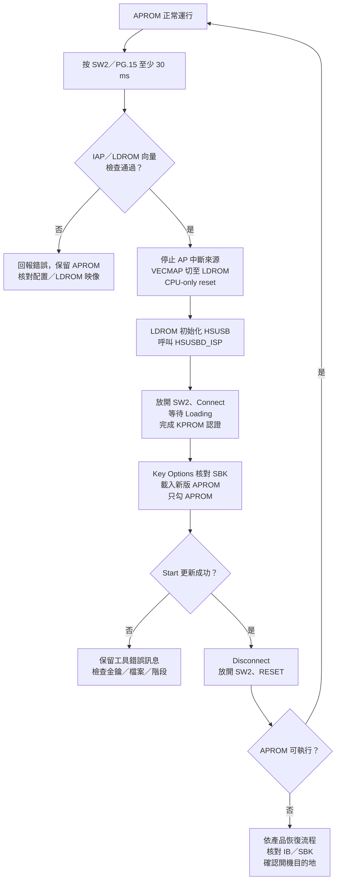

[開啟完整尺寸的 SW2 更新流程圖](assets/diagrams/repeat-update.svg)。

1. APROM 執行時，按住 **SW2（PG.15）至少 30 ms** 再放開。
2. 範例 APROM 檢查 IAP／向量，停止現有中斷來源，以 VECMAP＋CPU-only reset 切至 LDROM。
3. 使用 SecureBootTool Connect，完成 [認證與 Key Options](#secure-tool-connection)。
4. 載入新版 APROM。Programming **只勾 APROM**，保留既有 LDROM 入口，按 Start。

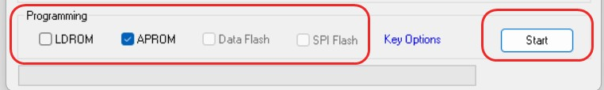

5. 等待 **Programming flash, OK** 及進度完成，再 Disconnect。

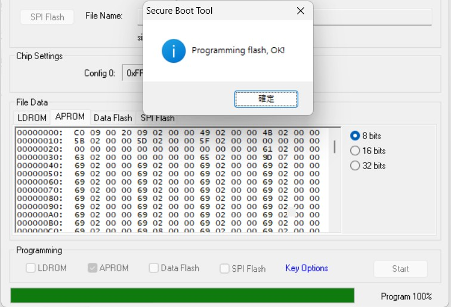

6. 放開 SW2，再 RESET 或重新上電，確認應用程式正常運行。

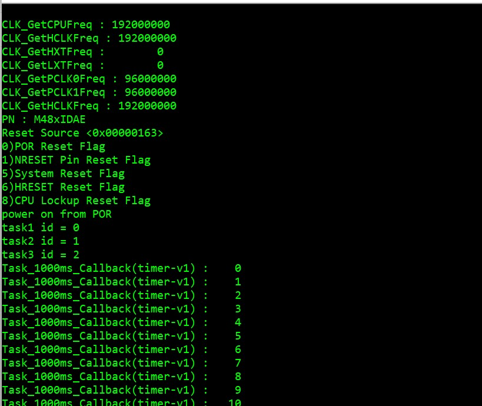

7. 再按 SW2、重新 Connect，確認仍能進入 KPROM 視窗，保有下一次更新入口。

本參考實作在 UART 回報 `-1` 時表示 IAP 條件不符，`-2` 表示 LDROM 初始 MSP／reset vector 不符合入口配置。此行為屬目前範例；移植到其他 APROM 時，需調整周邊停止、RTOS／DMA 及向量配置。

### 驗證範圍

| 項目 | 目前證據 |
| --- | --- |
| ICP 配置 Boot Loader、Security Lock、KPROM、SBK；SecureBootTool 寫入 LDROM／APROM | 使用者確認可執行；由指定工具及提供畫面支持 |
| KPROM 認證、Key Options、APROM-only 更新、重置運行、再次 SW2 連線 | 使用者回報核心循環通過；非網頁製作者獨立硬體測試 |
| LDROM／CONFIG 逐 byte 保留、不同映像反覆切換、斷電恢復 | 尚未驗證 |
| 自訂 LDROM＋僅修改 APROM 的 SRAM 接管方案 | 尚未實作／編譯／硬體驗證 |

出現 KPROM 視窗代表到達認證入口；工具回報寫入成功、重置後可執行及再次進入更新，分別是後續驗收步驟。

## 7. 自訂 LDROM：更新範圍與入口條件

### 7.1 保留 boot code 的適用條件

既有 LDROM 可能已提供一般 ISP，或在每次開機先執行產品自己的檢查。Secure ISP 入口不必固定放在 LDROM；若只有 APROM 可修改，可評估將接管更新的執行段放到 SRAM。

**此方案尚未實作與實測。** 本頁第 3～6 節的硬體成功回報只涵蓋專用 LDROM 方案，不能延伸為任意自訂 LDROM 都已相容。

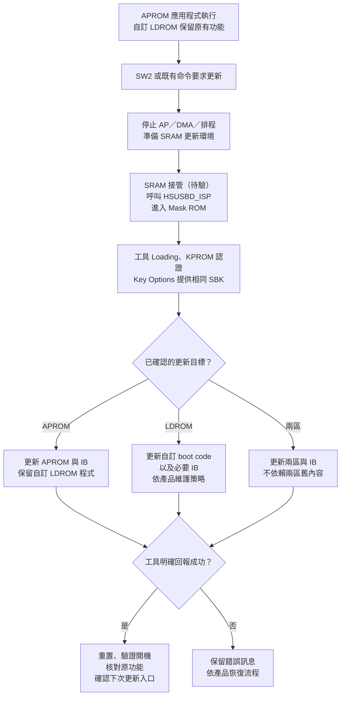

### 7.2 依更新範圍選擇執行位置

[開啟完整尺寸的自訂 LDROM 整合圖](assets/diagrams/custom-ldrom.svg)。

| 更新目標 | 可評估的執行位置 | 操作與驗證條件 |
| --- | --- | --- |
| APROM，保留自訂 LDROM | APROM 觸發後，由 SRAM／ROM 接管 | APROM 內尚未搬出的 ISR、wrapper 或返回路徑會受到擦寫影響；新版仍須包含入口 |
| 僅 LDROM | 可評估由 APROM 呼叫 ROM API | 原廠有 APROM 更新 LDROM 的 API 範例；實際工具、IB 寫入區及執行依賴仍須驗證 |
| APROM 與 LDROM | ROM command mode，或完整 SRAM／ROM 更新環境 | 更新時不能依賴即將被替換的 APROM／LDROM 程式；同時確認驗證資料與恢復程序 |

「只在 APROM 增加一個 `HSUSBD_ISP()` 呼叫」不足以證明 APROM 能安全更新自己。API 主體雖在 ROM，呼叫 wrapper、USB ISR、向量、常數、RW 資料、堆疊與意外返回路徑仍須有安全的執行位置。

### 7.3 SRAM 接管與 IB 配置條件

| 項目 | 移植時的確認內容 |
| --- | --- |
| SRAM 模組 | APROM 保存載入映像；執行程式、RO／RW／ZI、向量、stack 明確保留 SRAM 空間 |
| ROM 工作 RAM | 本參考型號的 ROM 使用 `0x2000C000..0x2000FFFF`，共 16 KB；接管模組及其資料須避開 |
| 中斷與周邊 | 停止原 USB stack、DMA、SysTick、RTOS 排程等；更新階段仍須開放所需 HSUSB 中斷 |
| 執行依賴 | 最終 map／反組譯確認 USB ISR、BootIspLib wrapper、literal pool、veneer 與 fault／reset 路徑不依賴被擦寫區 |
| 完成行為 | 更新後重置，回到產品既有 Secure Boot 流程；不能返回已被替換的舊 APROM |

IB 位於正常開機目的區最後 **144 bytes**。對本頁的 512 KB APROM／4 KB LDROM 參考型號：

| CONFIG0[7]／正常目的地 | IB 位址 | 對整合的影響 |
| --- | --- | --- |
| 1／APROM | `0x0007FF70..0x0007FFFF` | APROM linker 必須保留該區；更新連同所需驗證資訊一起完成 |
| 0／LDROM | `0x00100F70..0x00100FFF` | 即使不更新自訂 boot code，APROM 驗證資訊的更新仍可能涉及 LDROM |

此型號 flash erase page 為 **4 KB**。當 IB 位於 LDROM 且需要更新時，必須確認工具如何保存／重建同頁 boot code；**保留 LDROM 程式功能與完全不寫 LDROM，屬於不同條件**。指定工具在此自訂配置下的保存行為尚未驗證。

若原 boot code 已占用 LDROM 最後 144 bytes，啟用此配置時也會發生 IB 空間衝突；即使 Secure ISP 入口放在 APROM／SRAM，仍須先處理該保留區。

Boot Option 也影響正常開機順序；若產品需要先由 LDROM 執行，不能只為移動 IB 而直接改成 APROM 開機。

### 7.4 保留一般 ISP 的相容條件

保留原 LDROM 程式後，還須驗證其一般 ISP 是否能在 KPROM／Secure Boot 配置下正常工作：

1. 寫入操作具備對應授權，符合實際 KPROM 保護範圍。
2. 更新受驗證區域後，同步部署與新版內容一致的 IB；驗證資料由具備 SBK 的受信任流程產生。
3. 原 boot code 的判斷、跳轉、一般 ISP 協定及救援入口維持產品需要的行為。
4. 分別測試正常更新、APROM 無法執行及更新中斷的恢復方式。

SW2 在 APROM 內時，需要 APROM 能執行該入口。對簽章有效但卡死的應用程式，不能保證僅靠該按鍵恢復。文件記載的 ROM 驗證失敗 command mode，亦須在實際產品上驗證。

## 8. 依狀態排查連線與更新

| 現象 | 所在階段 | 核對項目與處理方向 |
| --- | --- | --- |
| Waiting for usb connection，尚無 key 視窗 | USB 裝置／入口 | CON1 資料線、供電、ICP Disconnect、debug halt，以及目前是否執行 ROM／LDROM 更新入口 |
| Loading 後未繼續 | 通訊建立 | 工具版本、裝置是否重置或被占用；保留完整狀態與 Windows 裝置資訊 |
| Verifying KPROM Key，已出現視窗 | 認證入口已到達 | 輸入對應 Key0／Key1／Key2；尚未代表認證成功 |
| KPROM 驗證錯誤 | 金鑰／保護設定 | 核對原始紀錄及順序，留意錯誤次數限制；不以 SBK 代替 |
| Connected，Start 失敗 | 寫入／驗證資訊 | 目標區、BIN、Key Options 的 SBK、保護範圍及完整錯誤訊息 |
| Programming OK，重置後未執行 APROM | 開機／驗證 | 正常目的地、IB、SBK、映像與向量；依產品恢復流程處理 |
| 更新後 APROM 正常，但 SW2 無反應 | 軟體入口 | 新版是否保留輪詢／命令入口、按鍵腳位與消抖、主迴圈／工作執行緒是否運行 |
| 僅寫 LDROM、APROM 空白時無法連線 | 首次映像與配置組合 | 與已可連線的空白基準比對；IB／開機目的地是調查方向，根因未經 IB 讀回證實 |

錯誤紀錄保留工具版本、晶片型號、失敗階段、CONFIG／部署範圍與完整訊息。實際產品的金鑰內容不列入一般診斷資料。

## 9. 操作指南的驗收項目

| 流程 | 可觀察的完成條件 |
| --- | --- |
| ICP 首次配置 | 正確型號；CONFIG、KPROM、Secure Key 完成，保存對應部署紀錄 |
| SecureBootTool 連線 | Loading 完成，KPROM 認證通過，Connected 與晶片資訊正確 |
| 韌體更新 | 正確 SBK、映像與目標區；工具明確回報成功 |
| 更新後啟動 | 重置後進入預期開機流程，APROM 執行，原有功能可用 |
| 再次更新 | 新版仍可進入 Secure ISP；不同版本循環更新可重現 |
| 自訂 LDROM 回歸 | 一般 ISP、啟動與救援功能皆符合需求；IB 寫入範圍有紀錄 |
| 故障恢復 | APROM 空白／卡死與斷電中斷，均有經測試的對應處理流程 |

依實際部署的更新入口、Boot Option、目標區、映像檔與恢復方式，逐項核對上表結果。每個發佈的 APROM 映像都應保留相應更新入口，並驗證更新後仍可再次連線。

## 參考依據

- 使用者提供的 ICP／SecureBootTool 操作截圖與硬體回報；範例使用的 Boot Loader／Secure Key 強制勾選行為依此版本介面記錄。
- [Nuvoton AN0039：M480 Secure Bootloader](https://www.nuvoton.com/resource-files/AN_0039_M480_SecureBootloader_TC_Rev1.00.pdf)：第 5～9 頁的 ROM／RAM、IB 與金鑰；第 10～14 頁的 API 與使用範例。其其他版本工具畫面需與本頁 Key Options 介面區分。
- [Nuvoton ICP Programmer User Guide Rev2.06](https://www.nuvoton.com/resource-files/UM_ICP_Programming_Tool_EN_Rev2.06.pdf)：8.2.3 KPROM、8.2.4 Secure Boot Key 與 IB Programming。
- [Nuvoton M480 TRM Rev2.02](https://www.nuvoton.com/export/resource-files/TRM_M480_Series_EN_Rev2.02.pdf)：Boot Selection、IAP 與 FMC flash 配置；具體條件依完整晶片型號核對。
- Nuvoton BSP 的 `SampleCode/SecureBoot/HSUSBD_IAP`、`HSUSBD_FWUpdate` 與 `Library/FWUpdate/BootIspLib.h`；本參考採 Mask ROM API 路徑。
- `M480_SecureBoot_Demo.pdf` 第 11～14 頁：連線階段、KPROM 認證及 Key Options；`NUMAKER-PFM-M487_V3_0.pdf` 第 2～3 頁：SW2／PG.15、12 MHz HXT 與 CON1 HSUSB。
